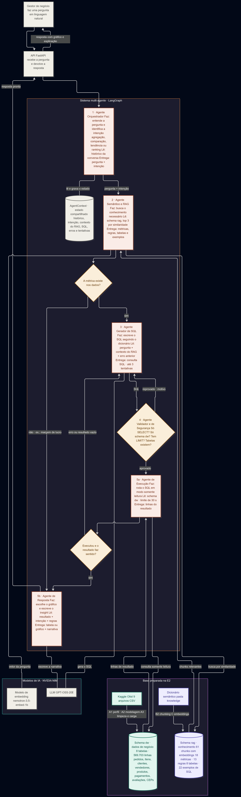

# E1 — Planejamento e Design do Sistema

**Período:** 22/10 a 23/10/2026 · **Foco:** Design · **Status:** ✅ Concluída

## 1.1 Entendimento do problema

**Empresa fictícia:** Vortex Marketplace — marketplace B2C brasileiro, 8.000
vendedores ativos, 120.000 pedidos/mês, R$ 480 milhões de faturamento anual.

**Usuários:**
- Gestores de negócio e coordenadores comerciais, que precisam de respostas
  rápidas mas não sabem SQL.
- Engenheiros de dados e analistas de BI, responsáveis por governar as fontes
  de dados e o dicionário semântico.

**A dor:** fila crítica de demandas ad-hoc (60+/semana, 15 dias de espera),
dashboards que só cobrem cenários previstos, métricas calculadas de forma
inconsistente entre analistas, e perda de agilidade comercial.

**KPIs-alvo:**

| Métrica | Hoje | Meta |
|---|---|---|
| Tempo de resposta ad-hoc | 15 dias | < 2 minutos |
| Fila do time de BI | 60+/semana | < 15/semana |
| Perguntas respondidas sem o BI | ~10% | > 70% |
| Consistência semântica | informal | 100% |
| Onboarding de novo gestor | 4 semanas | < 1 semana |

## 1.2 Arquitetura de agentes

Arquitetura multi-agente baseada em um **workflow condicional com loop de
correção**, com 5 agentes especializados:

1. **Orquestrador** — ponto de entrada, gerencia o estado da conversa e decide a sequência dos demais agentes.
2. **Semântico e RAG** — consulta o banco vetorial (pgvector) para buscar definições de métricas, schemas de tabela e exemplos de SQL validados.
3. **Gerador de SQL** — traduz a intenção + contexto do RAG em uma query SQL estruturada.
4. **Validador e Segurança** — análise estática da query: garante que é somente leitura (bloqueia `INSERT`, `DROP`, `DELETE`, `UPDATE`), verifica riscos de injeção.
5. **Execução e Resposta** — roda a query validada, formata a visualização e escreve a narrativa.

**Mapa de ação dos agentes** — o que cada um faz, de onde tira informação e o que entrega ao próximo, incluindo o loop de correção e as duas camadas de conhecimento (schema `dw` e schema `rag`) que alimentam o fluxo:

**Fluxo principal:** `Usuário → Orquestrador → Semântico/RAG → Gerador de SQL → Validador → Execução → Usuário`

**Loop de correção:** se o Validador encontrar um erro, ou se a execução
falhar, o erro volta para o Gerador de SQL, que corrige antes de uma nova
tentativa — sem que o fluxo falhe de imediato.

**Gestão de estado:** um `AgentContext` compartilhado carrega o histórico da
conversa, o plano, o contexto do RAG, o SQL gerado e os logs de erro. Para
evitar sobrecarga de contexto, os agentes intermediários passam só os
artefatos essenciais entre si.

## 1.3 Mapeamento dos dados

**Dataset escolhido:** [Olist Brazilian E-Commerce](https://www.kaggle.com/datasets/olistbr/brazilian-ecommerce)
— ciclo completo de pedido → entrega, 2016 a 2018, mais de 100 mil pedidos.

**O que alimenta o RAG:** o banco vetorial **não** guarda as transações
brutas — isso seria ineficiente e desnecessário. Ele guarda só a camada de
metadados e governança:
- Dicionário de dados estruturado (descrição de tabelas e colunas).
- Regras de negócio e fórmulas das métricas-chave.
- Exemplos de pares pergunta → SQL validado.

Dois desafios de qualidade já identificados nesta fase (confirmados e
quantificados na E2): valores nulos em datas de entrega de pedidos cancelados,
e inconsistências de formatação em nomes de cidade/estado.

## 1.4 Stack técnico

| Decisão | Escolha | Justificativa resumida |
|---|---|---|
| Orquestração de agentes | **LangGraph**, não CrewAI | O fluxo de consulta a banco de dados precisa de controle explícito passo a passo, com loop de correção obrigatório — não da autonomia aberta que o CrewAI favorece entre agentes conversando livremente |
| Chunking e embedding | Chunks por **unidade de significado**, não por tamanho fixo | Evita quebrar definições de métrica no meio |
| Banco vetorial | **PostgreSQL + pgvector** | Dados relacionais e metadados de inteligência no mesmo banco, simplificando a infraestrutura |
| API | **FastAPI** | Recebe a pergunta de forma assíncrona e orquestra os agentes por trás |

## Observações

O entregável 1.5 (repositório GitHub) foi propositalmente adiado: a decisão
foi desenvolver primeiro na prática para só então definir a melhor estrutura
de pastas — o que se confirmou acertado, já que a estrutura atual do
repositório nasceu naturalmente do código rodando nas entregas seguintes.

**Documento completo da E1** (com o detalhamento ponto a ponto e o diagrama
do fluxo): mantido no caderno de anotações do projeto (Obsidian), fora deste
repositório.
